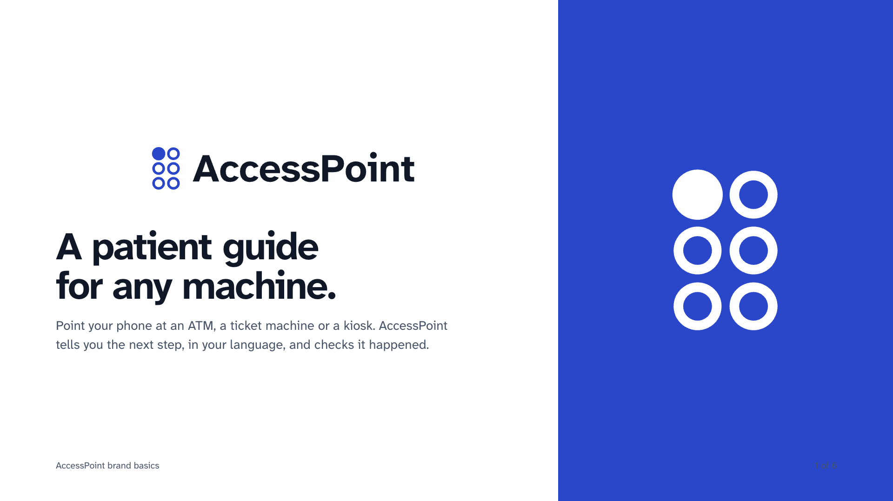

# AccessPoint

**A patient guide for any machine.** Scan the "Need help? Scan me" sticker on an ATM, ticket machine or kiosk, send a photo of the screen on Messenger or WhatsApp, and AccessPoint tells you the one next step, in your language. It stops you when something looks wrong, and it never needs your PIN.

Built for the Meta Global AI Developer Hackathon (Build for Your World), 27 Oct to 4 Nov 2026, by [Aljabri Alam](https://www.linkedin.com/in/aljabri-alam/).



## Who it's for
Self-service machines replaced people at the counter just as the world started to age. AccessPoint is for the older person whose bank branch closed, the blind traveller at a ticket machine, and the migrant worker facing a screen in a language they don't read.

## How it uses Meta's tools

| Meta tool | What it does in AccessPoint |
|---|---|
| **Messenger** and **WhatsApp Cloud API** | Where people use it. No app to install: the sticker's QR opens the chat with the machine already known |
| **Muse Spark 1.3** | Reads the photo and plans ONE step as strict JSON (screen type, options, target, money shown, risk) in the person's language |
| **SAM 3.1** | Must find the button Muse Spark named in the same photo. Its box gives the position words and the "See where" view. No match means "check the label", never a guess |
| **Muse Voice Transcribe** | Voice notes in 25 languages, biased toward the labels on screen |
| **Muse Image** | Artwork for the sticker kit only, never for guidance |

## Guardrails
The models suggest; code decides. Safety messages are fixed text, never model output. Full list: [docs/GUARDRAILS.md](docs/GUARDRAILS.md).
- PIN screen: "type it yourself, cover the keypad". The photo is deleted at once.
- A transfer you didn't ask for, a different amount, or a suspicious screen: stop, press Cancel.
- Unreadable photo: take another one. No guessing.
- Text on the machine's screen can't give the model orders.
- Photos kept 10 minutes, chat state 1 hour, voice notes never. Type "delete" to erase everything.

## What's in this repo

| Folder | What it is | Status |
|---|---|---|
| [`bot/`](bot) | The live product: Messenger and WhatsApp bot on a Cloudflare Worker, calling Muse Spark, SAM 3.1 and Muse Voice. [Setup](bot/README.md) | Deployed; 15 automated tests |
| [`mobile/`](https://github.com/aljabrialam/accesspoint-mobile) (submodule) | iPhone app (Expo, React Native) showing the full camera experience in scenario mode: 8 scripted scenarios on 6 machine types, voice, 25 languages, the sticker start screen and the guardrails screen | Scenario mode (scripted, no live camera yet); 11 Maestro flows pass |
| [`demo/video/`](demo/video) | The 4K demo video, generated from code: simulator recordings, narration, captions, original music | Reproducible build |
| [`brand/`](brand) | Logo system (the letter A in braille), palette, type, brand board | |
| [`docs/`](docs) | Guardrails | |

## Run it

```
git clone --recurse-submodules https://github.com/aljabrialam/accesspoint.git

# Bot: tests, then a real-model check on 5 clean machine screens
cd bot && npm test && npm run live-check        # live-check needs MODEL_API_KEY in .env

# iPhone app (iOS Simulator)
cd mobile && npm install && npx expo start      # then press i
npm run e2e                                     # Maestro flows

# Demo video
cd demo/video && python3 build.py timeline && node render.mjs && python3 build.py compose
```

## Honest notes
- The iPhone app runs scripted scenarios on demo machines we drew; it is labelled "Scenario mode" everywhere. The bot is the part that runs on Meta's models.
- Messenger replies only reach app testers until Meta's app review; the WhatsApp test number serves up to 5 verified numbers.
- The app's spoken guidance uses pre-generated Microsoft Edge neural voices (edge-tts); Muse Voice Transcribe is speech-to-text only.

## Credits and licences
Code: [MIT](LICENSE). Fonts: Inter and Atkinson Hyperlegible Next, both SIL Open Font License (`brand/fonts/`). Background music is original, synthesised in `demo/video/music.py`.
