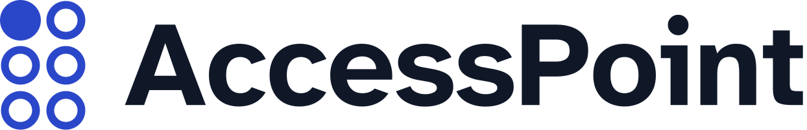
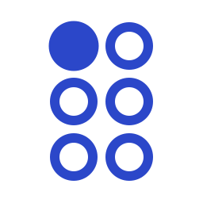
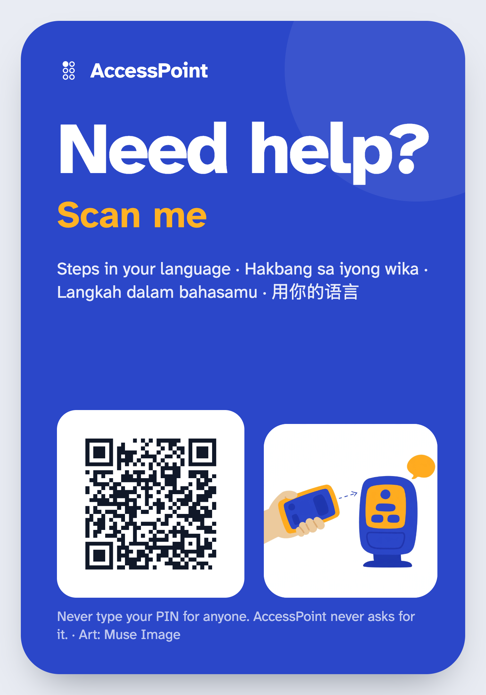
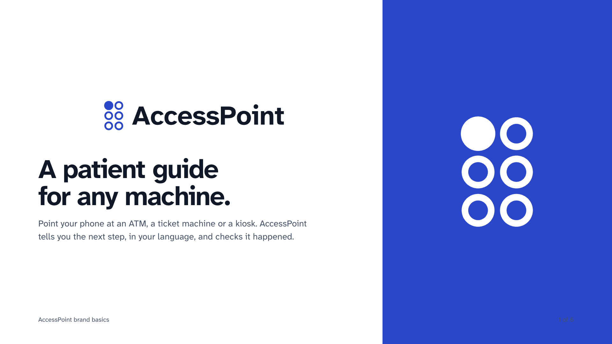
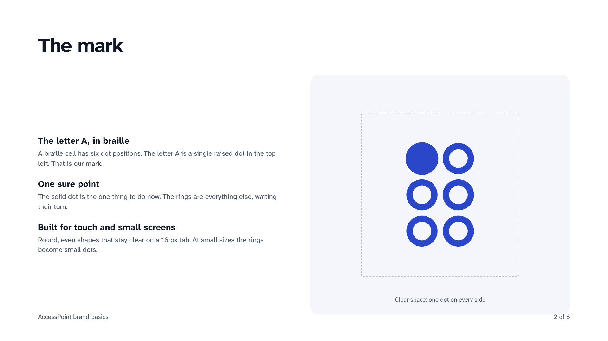
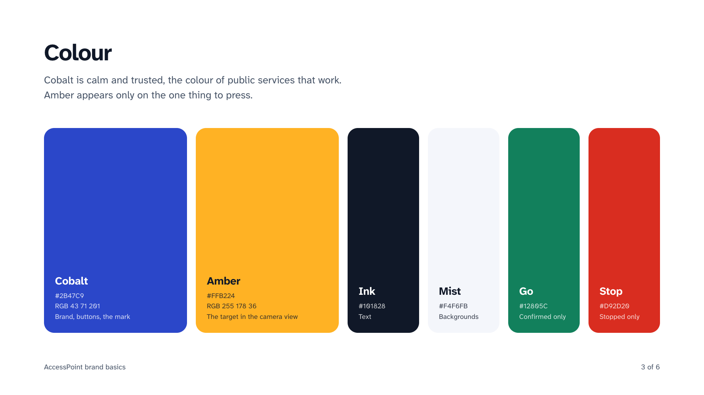
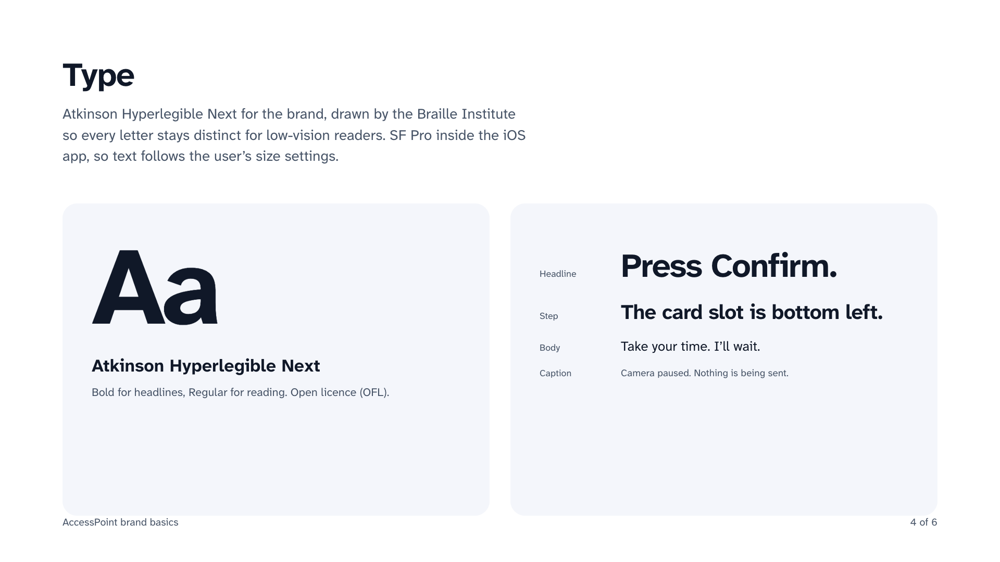
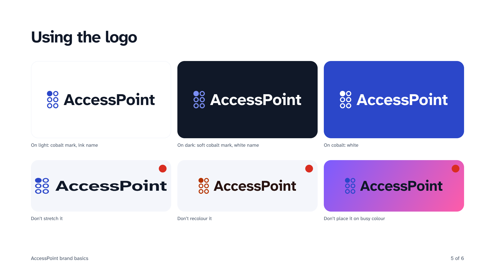
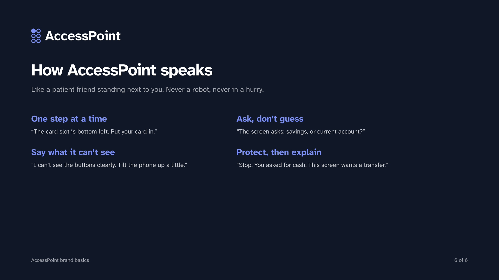

# Name, logo and brand

## The name

**AccessPoint.** An access point is the place where you get in: a door, a gate, the point where a network lets you on. Self-service machines have become the access point to trains, flights, clinics and shops, and for many people they are where access stops. AccessPoint is the helper at that point.

It also says what the product is not: it isn't a new app to learn or an account to make. It meets people at the machine and in the chat apps they already use.

## The logo: the letter A in braille

The mark is a **braille cell**: six dot positions in two columns. In braille, the letter **A** is a single dot in the top-left position (dot 1). So the mark is:

- **A for AccessPoint**, written in braille, the script built for people who can't read print.
- **One raised dot among six:** the first step. AccessPoint gives one step at a time.
- **Solid dot, five rings:** where you are, and the steps still to come.

It is drawn from circles only, so it stays legible at 16 px (`mark-small-*` uses solid dots at small sizes), embosses well on a tactile sticker, and doesn't depend on any alphabet, which suits a product used in 25 languages.

## Colour

| Name | Hex | Use |
|---|---|---|
| **Cobalt** | `#2B47C9` | The brand: the mark, every action, buttons, links |
| **Amber** | `#FFB224` | Only the target: the outline around the button to press, in the app and on "See where" |
| Ink | `#101828` | Text |
| Mist | `#F4F6FB` | Backgrounds |
| Night | `#7B8FF5` | The mark on dark backgrounds |
| Go | `#12805C` | Done, confirmed |
| Stop | `#D92D20` | Stop messages |

**Why Cobalt and Amber:** blue and amber stay distinct for the most common colour-vision differences, and Cobalt on white has a contrast ratio of 7.4:1, which passes WCAG AAA for text. Amber is kept for one meaning only, "press here", so it never competes with anything else on screen.

## Type

**Atkinson Hyperlegible Next**, by the Braille Institute, designed so letters that look alike in other fonts (I, l and 1; O and 0; b and d) are easy to tell apart for people with low vision. Free under the SIL Open Font License (`brand/fonts/`). The iPhone app uses the system font (SF Pro) so it follows the person's Dynamic Type size.

## Voice

Plain, warm and short. One step at a time. Never rushed, never blaming ("The screen says…", not "You pressed the wrong button"). No dashes in visible text. Fixed safety messages say exactly what to do: "Stop. Press Cancel."

## The sticker

"Need help? Scan me", one per machine, with the QR code, a line in the languages of the people who use that machine, and a reminder that AccessPoint never asks for a PIN. The illustration was made with **Muse Image**. Source: [`docs/sticker/sticker.html`](sticker/sticker.html). Production plans (tactile bump, NFC, machine profiles): [PRODUCTION.md §7](PRODUCTION.md#7-the-sticker-programme).

## Brand board

Six slides with the mark, colour, type, logo use and tone of voice: `brand/kit/brand-1.png` to `brand-6.png` (source `brand/board.html`).

| | | |
|---|---|---|
|  |  |  |
|  |  |  |

## Files

| Asset | Path |
|---|---|
| Logo lockups (light, dark, mono, stacked, on Cobalt) | `brand/logo/lockup-*.svg` |
| Mark (Cobalt, ink, white, small) | `brand/logo/mark-*.svg` |
| App icons (1024) | `brand/logo/png/app-icon-*.png` |
| Favicons and web icons | `brand/logo/export/` |
| Sticker art (Muse Image) | `brand/sticker/muse-image-art.png` |
| Rebuild every logo | `python3 brand/build_brand.py` |
