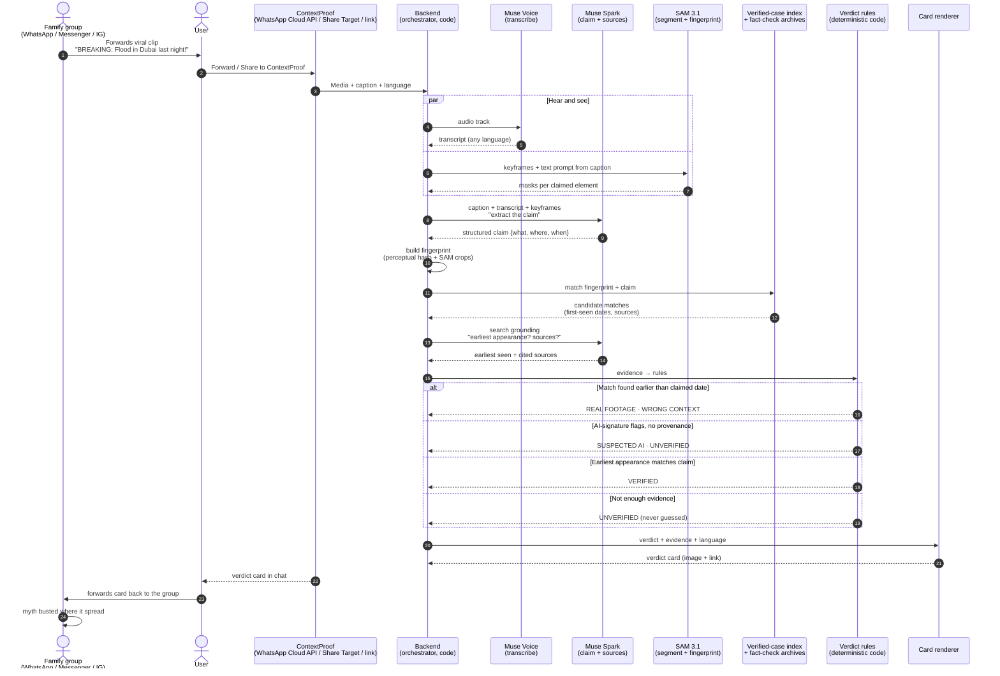

# ContextProof — sequence diagram

**Fail-closed rule:** every verdict that isn't backed by evidence becomes `UNVERIFIED` — the system never guesses. Low-confidence matches pause and ask the user ("forwarded as new or old?") instead of assuming.
